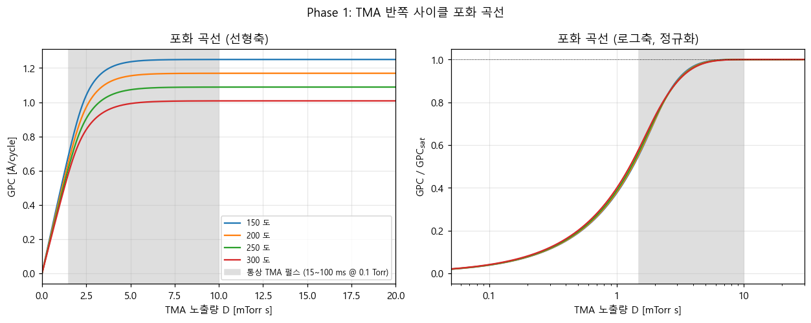
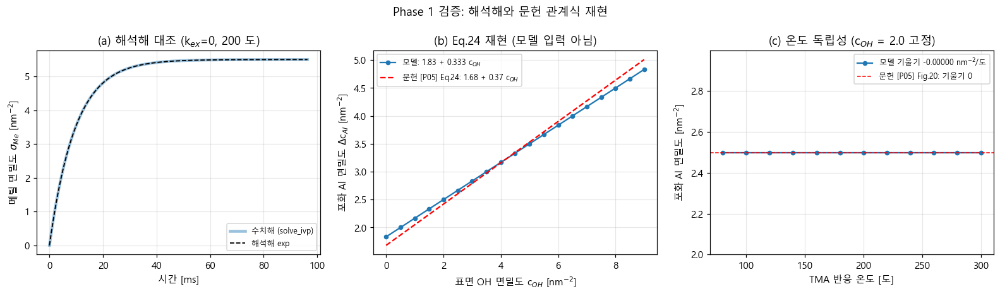
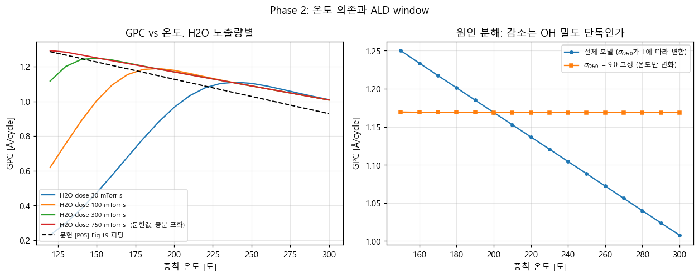
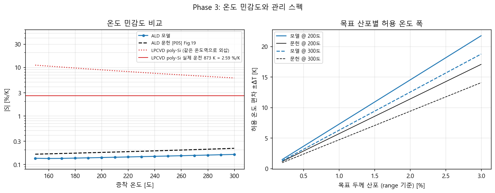
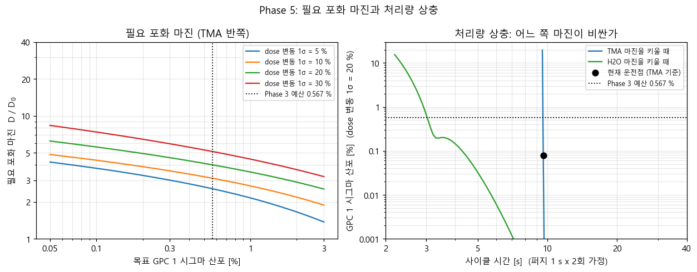

# ALD Al2O3 표면 반응 모델링

TMA + H2O ALD로 Al2O3를 증착할 때의 표면 반응을 mean-field 미세동역학 모델로 구현하고, 박막공정 지표(GPC, 포화 노출량, 공정 창, 두께 산포)를 계산한다.

문헌 동역학 파라미터 기반이다. 이 저장소에 새로운 양자화학 계산은 포함하지 않는다.

---

## 무엇을 하는가

ALD 한 사이클은 두 반쪽으로 나뉜다.

    H2O 반쪽 끝 -> OH 종단 (Al-OH)   -> TMA가 붙을 자리
    TMA 반쪽 끝 -> 메틸 종단 (Al-CH3) -> H2O가 붙을 자리

이 표면 상태 변화를 상미분방정식으로 적분해서 다음을 구한다.

- 노출량(dose)에 따른 포화 곡선과 GPC
- 온도에 따른 GPC 변화와 그 원인 분해
- 온도 편차가 만드는 두께 산포, 목표 산포에서 역산한 허용 온도 폭
- 전구체 공급이 흔들릴 때의 GPC 산포와 필요한 포화 마진

---

## 검증 결과

모델 정확도부터 적는다. 아래가 이 프로젝트의 결론이다.

### 문헌 대조 오차

| 항목 | 모델 | 문헌 | 오차 |
|---|---|---|---|
| GPC @ 220도 | 1.137 Å/cycle | 1.150 (Arts 2019 실측) | **-1.2 %** |
| GPC @ 220도 | 1.137 Å/cycle | 1.087 (Puurunen 피팅) | +4.6 % |
| GPC 150~300도 | | Puurunen 2005 Fig.19 | **평균 4.9 %, 최대 8.5 %** |
| GPC 온도 기울기 | -0.00668 nm^-2/도 | -0.0082 +/- 0.0024 | -18.6 % (1σ 안) |

### 예측 검증: 모델에 넣지 않은 관계식

동역학 모델은 파라미터를 조정하면 어떤 곡선이든 만들 수 있다. 그래서 **모델 입력이 아닌 문헌 관계식을 재현하는지**를 따로 봤다. 모델에 넣은 것은 입체 포화와 질량수지뿐이다.

| 항목 | 모델 | 문헌 | 오차 | 출처 |
|---|---|---|---|---|
| Al-OH 상관식 절편 | 1.833 | 1.680 | +9.1 % | Puurunen 2005 Eq.24 |
| Al-OH 상관식 기울기 | 0.3333 | 0.3700 | -9.9 % | 같음 |
| Me/Al 비 (c_OH = 0) | 3.00 | 3.0 | 0.0 % | Puurunen 2005 Fig.23 |
| Me/Al 비 (c_OH = 3) | 1.94 | 2.0 | -2.9 % | 같음 |
| Me/Al 비 (c_OH = 6) | 1.43 | 1.5 | -4.4 % | 같음 |
| 온도 독립성 기울기 | 0.000000 | -0.0003 +/- 0.0005 | 범위 안 | Puurunen 2005 Fig.20 |

**세 관계식 모두 10 % 이내로 재현된다.**

### 코드 정확성 (모델 정확도와 별개)

위와 구분해서 읽어야 한다. 아래는 코드가 식을 맞게 푸는지 확인한 것이지 모델이 현실과 맞는지가 아니다.

| 항목 | 잔차 |
|---|---|
| 해석해 대조 | 1e-11 |
| 질량수지 | 1e-15 |
| 적분 수렴 | 1e-12 |
| 미지 파라미터 둔감성 | 1e-5 |

Phase별로 4~10종이 매 실행마다 자동으로 돌고 통과 여부를 출력한다.

---

## Phase 1 결과

### 포화 곡선

| T [도] | D0 [mTorr s] | GPC_sat [Å/cycle] | 포화 시간 [ms] |
|---|---|---|---|
| 150 | 1.7 | 1.250 | 17.4 |
| 200 | 1.7 | 1.169 | 17.2 |
| 250 | 1.7 | 1.088 | 16.9 |
| 300 | 1.7 | 1.008 | 16.5 |

조건: P_TMA = 0.1 Torr, beta_TMA = 1.0e-3

**D0가 온도에 거의 무관하다.** 온도에 따라 변하는 것은 도달하는 높이지 도달 속도가 아니다. 포화 속도는 흡착이 정하고, 흡착 플럭스의 온도 의존은 1/sqrt(T)로 약하다.

### 포화를 거는 원인

전 온도(150~300도)에서 **입체 장애**다. OH는 전부 소모되지만 그것이 정지 원인은 아니다. OH 소모가 끝난 뒤에도 해리 경로로 흡착이 이어지고, 메틸기가 표면 면적을 다 채운 시점에서 멈춘다.

---

## 모델 구조

입체 차폐를 만드는 것은 메틸기인데 Me/Al 비가 1.5에서 3까지 변한다. 그래서 Al과 메틸을 따로 추적한다.

    흡착        TMA -> 표면.  Al +1, Me +3.   rate = beta_ads x Gamma x theta_free
    리간드교환   Me* + OH* -> CH4(g).  Me -1, OH -1.   rate = k_ex x s_Me x s_OH

    theta_free = 1 - a_Me x s_Me
    Gamma = P / sqrt(2 pi m k_B T)                    Hertz-Knudsen

OH가 많으면 메틸이 빨리 제거되고, 그만큼 면적이 열려 Al이 더 붙는다. 이 인과가 위 검증표의 Al-OH 상관식을 만들어낸다.

포화 시 성립하는 관계는 다음과 같고, 이것을 매 적분 스텝에서 잔차로 검사한다.

    3 s_Al = s_Me + (소모된 OH)

### 미지 파라미터 처리

리간드교환 속도상수 k_ex는 문헌에 절대값이 없다. Puurunen 2005는 "리간드교환이 흡착보다 먼저 완료된다"는 정성 서술만 준다.

무차원비 Da_ex로 두고, Da_ex >= 100에서 포화값이 상대산포 1.5e-5로 수렴함을 확인했다. 문헌이 서술한 조건이 바로 그 구간이다. **미지 파라미터가 결론을 바꾸지 않는다.**

---

## 파라미터

11개 항목 전부 문헌 출처와 측정 조건을 기록했다. 추정으로 채운 값은 없다. 상세는 [`02_파라미터_조사.md`](02_파라미터_조사.md).

| 파라미터 | 값 | 출처 |
|---|---|---|
| 표면 OH 면밀도 | 9.0 nm^-2 (200도) -> 7.0 (300도) | Knozinger 1978 via Puurunen 2005 |
| TMA 초기 반응확률 | (0.5~2)e-3 @ 220도 | Arts 2019 |
| H2O 초기 반응확률 | 1.5e-5 (150도) -> 4e-4 (300도) | Arts 2019, Vandalon 2016 |
| TMA당 소모 OH 수 | 2.70 | Puurunen 2005 Eq.24 |
| 차폐 면적 | 0.139 nm^2 (이론) / 0.18 (역산) | Puurunen 2003 |
| 기준 GPC | 6.3 - 0.0082 T(도) nm^-2 | Puurunen 2005 Fig.19 |
| 탈수산화 활성화에너지 | 0.72 ~ 1.09 eV (ALD 온도역) | Zhuravlev 2000 |
| 막밀도 | 3.5 / 3.0 g/cm3 | Puurunen 2005 / Groner 2004 |

탈수산화 활성화에너지는 비정질 **실리카** 값이다. 알루미나 실측을 찾지 못했다. 반응 형태가 같아(2 M-OH -> M-O-M + H2O, 실험 반응차수 n = 2.00) 대체값으로 쓰되 소재가 다름을 결론에서 명시한다.

---

## 진행 상황

| Phase | 내용 | 상태 |
|---|---|---|
| 1 | 반쪽 사이클 포화, dose vs GPC | 완료 |
| 2 | 온도 의존, GPC vs T, ALD window | 완료 |
| 3 | 온도 편차에 따른 두께 산포, 허용 ΔT 역산 | 완료 |
| 4 | 하지막별 초기 OH 밀도 차이, 인큐베이션 | 완료 |
| 5 | 전구체 공급 변동에 따른 GPC 산포, 필요 포화 마진 | 완료 |

## Phase 2 결과: ALD window는 dose가 만든 겉모습이다

TMA/H2O 계에 **평탄한 ALD window는 없다.** H2O 노출량이 충분하면 150~300도 전 구간에서 GPC가 단조 감소한다.

감소 원인을 모델로 분해했다. 표면 OH 밀도를 9.0 nm^-2에 고정하고 온도만 바꾸면 **온도 의존이 0.14 %만 남는다.** 반응 메커니즘도 반응확률도 충돌 플럭스도 아니고, 표면 OH 밀도 감소 단독이 원인이다.

그런데 H2O 노출량을 줄이면 저온에서 봉우리가 생긴다.

| H2O dose [mTorr s] | GPC 최대점 |
|---|---|
| 30 | 1.110 Å/cyc @ 240도 |
| 100 | 1.188 Å/cyc @ 190도 |
| 300 | 1.248 Å/cyc @ 150도 |
| 750 (문헌값, 충분 포화) | 최대점 없음. 단조 감소 |

**봉우리 위치가 물질의 성질이 아니라 H2O dose의 함수다.** 흔히 "ALD window"라 부르는 그 모양이 여기서는 H2O 반쪽이 완결되지 못해 생긴 것이다.

Puurunen 2005는 이 형태에 대해 "불완전 반응이 만든 artefact일 수 있다"고 경고했다. 모델이 그 경고를 정량으로 재현한다.

양산 관점의 함의: 장비에서 관측된 ALD window가 진짜 자기종결 한계인지 단순한 H2O 노출 부족인지 구분하려면, dose를 늘려가며 봉우리가 움직이는지 봐야 한다. 움직이면 물질의 window가 아니라 레시피의 한계다.

### H2O 반쪽이 병목이다

| T [도] | H2O 특성시간 [ms] | TMA 특성시간 [ms] |
|---|---|---|
| 150 | 677 | 10 |
| 200 | 209 | 10 |
| 300 | 37 | 11 |

**20~70배 차이나고 저온일수록 벌어진다.** 반응확률의 온도 의존이 H2O에서만 뚜렷하기 때문이다(150도에서 300도로 가면 약 10배). 저온 ALD에 긴 물 펄스가 필요한 이유이고, Arts 2019가 관측한 soft-saturation이 저온에서 심한 것과 같은 방향을 가리킨다.

## Phase 3 결과: 온도 관리 스펙

### ALD가 둔감한 것은 맞지만 무시할 수 있는 항은 아니다

    LPCVD poly-Si (873 K, Ea 1.7 eV)   |S| = 2.588 %/K
    ALD Al2O3 (200도)                   |S| = 0.138 %/K (모델) / 0.176 %/K (문헌)

**19배 둔감하다.** 그런데 규격도 그만큼 빡빡하다. 두께 규격을 3σ로 잡고 온도와 dose를 제곱합으로 나누면:

| 규격 | 허용 두께 1σ | σ_T = 2 K일 때 온도가 쓰는 몫 |
|---|---|---|
| ±1 % | 0.333 % | 0.352 % (**105 %, 초과**) |
| ±2 % | 0.667 % | 0.352 % (53 %) |

Cp ≥ 1.33을 만족하려면 규격 ±1 %에서 **σ_T ≤ 1.43 K**가 필요하다.

이 프로젝트를 시작할 때는 "ALD는 온도에 둔감하니 병목은 dose일 것"이라고 적어뒀는데, 계산이 그 예상을 반박했다. 코드에 결론을 하드코딩했다가 표와 모순되는 것을 발견하고 계산에서 뽑도록 고쳤다.

### 관리 스펙 (보수적인 문헌 기준, range 산포)

| 목표 두께 산포 | 200도 | 300도 |
|---|---|---|
| 0.5 % | ±2.8 K | ±2.3 K |
| 1.0 % | ±5.7 K | ±4.7 K |
| 2.0 % | ±11.4 K | ±9.4 K |

### 예측 가능성도 ALD의 장점이다

민감도가 작은 것만이 아니다. GPC(T)가 선형이라 선형 근사가 ΔT = 50 K에서도 정확하다. LPCVD는 Arrhenius라 +50 K에서 선형 예측을 46 % 벗어나고 부호에 따라 비대칭이다.

단, ALD 쪽 선형성은 입력한 σ_OH0(T)가 선형 실측 관계라서 물려받은 성질이다. 독립적인 예측이 아니다. 다만 문헌 GPC(T)도 선형 피팅이므로 선형성 자체는 실측으로 뒷받침된다.

---

## Phase 5 결과: 어느 쪽 마진이 비싼가

고체 전구체는 증기압이 불안정해 사이클마다 실제 dose가 흔들린다. 그 변동을 흡수하려면 포화 마진이 얼마나 필요한가.

| dose 변동 1σ | TMA 필요 마진 | H2O 필요 마진 |
|---|---|---|
| 5 % | 2.6 | 3.4 |
| 20 % | 4.0 | 5.2 |
| 50 % | 8.9 | 11.5 |

(목표: Phase 3이 넘긴 두께 1σ 예산 0.567 %. dose 분포는 로그정규)

### 마진 비용은 두 반쪽이 비대칭이다

같은 배수의 마진을 확보해도 드는 시간이 다르다. TMA 반쪽의 특성시간이 약 10 ms인데 H2O 반쪽은 200도에서 209 ms, 150도에서 677 ms다.

| | 마진 1 -> 20으로 늘릴 때 노출 시간 증가 |
|---|---|
| TMA | 0.02 s -> 0.34 s |
| H2O | 0.18 s -> 3.55 s |

**TMA 마진은 거의 공짜이고 H2O 마진이 시간을 쓴다.** 물을 과다 투입하는 레시피가 있다면 사이클 시간이 거기서 새고 있을 가능성이 높다.

이것은 민감도 진술이지 특정 레시피에 대한 개선 제안이 아니다. 비교할 실제 장비 레시피가 없고, 절대 사이클 시간은 가정한 압력과 퍼지 시간에 의존한다(아래 한계 참조).

### 부수 발견: 지수형 가정은 위험하다

Phase 1에서 실제 포화 곡선이 지수형이 아님을 확인했다. 그 차이가 여기서 드러난다.

| 마진 | TMA 실제 민감도 | 지수형 가정 |
|---|---|---|
| 1 | 0.885 | 0.582 |
| 3 | 0.058 | 0.157 |
| 5 | 0.003 | 0.034 |

**저마진에서는 위험을 과소평가하고 고마진에서는 과잉 설계한다.** 또 포화 곡선이 오목해서 dose가 대칭으로 흔들려도 GPC 평균이 내려간다(마진 2에서 -0.6 %). 변동은 산포만이 아니라 평균 두께도 떨어뜨린다.

## 한계

정직하게 적어둔다.

- **GPC가 문헌보다 2~8 % 높다.** 포화 메틸 밀도를 문헌 관측 범위(5~6 nm^-2)의 중간값 5.5로 잡은 결과다. Al-OH 상관식 절편이 함의하는 5.04를 쓰면 문헌에 거의 붙지만, 그것은 결과에 맞추는 캘리브레이션이라 감도 분석으로 영향 범위를 명시하는 쪽을 택했다.
- **soft-saturation을 재현하지 못한다.** Arts 2019가 H2O 반쪽에서 관측한 비Langmuir 거동이다. 이 모델은 Langmuir 형이다. 저온(150도) 결과 해석 시 한계로 명시한다.
- **포화 곡선이 정확한 지수형이 아니다.** 지수형으로 근사하면 RMS 잔차가 3~5 % 남는다. 흡착이 면적을 채우는 동시에 리간드교환이 면적을 되돌려주기 때문이다. Phase 5는 실제 곡선으로 계산한다.
- **실측 포화 곡선 원데이터가 없다.** 곡선의 절대 스케일은 통상 펄스 시간과 자릿수만 대조했다. 형태 자체는 예측으로 남는다.
- **절대 사이클 시간은 계산하지 않는다.** H2O 기준 dose 750 mTorr s는 Arts 2019가 종횡비 10000 구조를 채우는 데 쓴 값이고, 이 모델은 평판 표면이다. 압력(0.1 Torr)과 퍼지 시간(1 s x 2회)도 문헌값이 아니라 가정이다. 두 반쪽의 상대 비용 비교만 유효하고 초 단위 절대값은 의미가 없다.
- **비교할 실제 레시피가 없다.** 장비도 기존 공정도 없으므로 이 프로젝트는 개선 실적을 주장하지 않는다. 산출물은 민감도와 관리 스펙이다.

---

## 실행

Python 3, numpy, scipy, matplotlib.

    python src/phase1_saturation.py

검증 6종이 자동으로 돌며 통과/실패를 출력한다. 그래프는 `fig/`에 저장된다.

---

## 파일 구성

    CLAUDE.md              프로젝트 지침과 작업 규칙
    01_모델설계.md          상태변수, 지배식, 가정, 단위, 검증 계획
    02_파라미터_조사.md     파라미터 값과 출처, 감도 분석 대상
    03_결과.md             결과 색인과 요약
    03_결과/               Phase별 상세 기록
    src/                   파이썬 스크립트
    fig/                   그래프
    문헌/                  논문 PDF (저작권 문제로 저장소에서 제외)

---

## 주요 참고문헌

- R. L. Puurunen, *J. Appl. Phys.* **97**, 121301 (2005). TMA/H2O ALD 표면화학 리뷰
- K. Arts et al., *J. Vac. Sci. Technol. A* **37**, 030908 (2019). 반응확률 측정
- L. T. Zhuravlev, *Colloids Surf. A* **173**, 1 (2000). 비정질 실리카 표면 탈수산화
- M. D. Groner et al., *Chem. Mater.* **16**, 639 (2004). 저온 Al2O3 ALD
- A. Yanguas-Gil, J. W. Elam, *Chem. Vap. Deposition* **18**, 46 (2012). 확산반응 연속체 모델

전체 목록과 각 값의 측정 조건은 [`02_파라미터_조사.md`](02_파라미터_조사.md) 3절에 있다.
