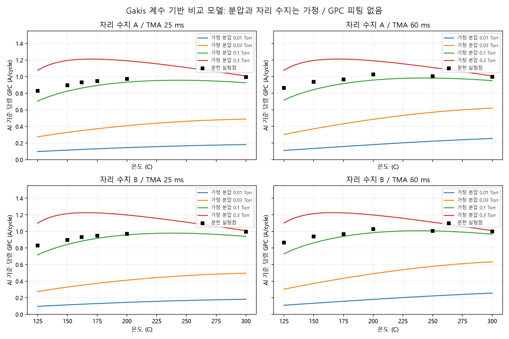

# Gakis 계수 기반 GPC 비교 결과

기존 모델/결과는 수정하지 않고 새 폴더에서 계산했다. 저자 CFD/보충자료 완전 재현이 아닌 가정을 명시한 평균장 비교 모델이다.

## 결과

동일 논문 Fig3 실험12점과 비교. 500사이클 평균Al당량GPC, 300C는550사이클. 독립 실험 검증/파라미터 식별 완료를 뜻하지 않는다.

|가정 분압(Torr, 두 전구체 동일)|A MAPE(%)|B MAPE(%)|A RMSE(A/cycle)|B RMSE(A/cycle)|
|---|---:|---:|---:|---:|
|0.01|83.87|83.88|0.7944|0.7944|
|0.03|56.38|56.02|0.5342|0.5311|
|0.1|7.75|5.80|0.0793|0.0649|
|0.3|20.73|21.99|0.2146|0.2278|

MAPE=mean(abs(pred/obs-1))*100。RMSE=sqrt(mean((pred-obs)^2))。0.1Torr는 기존 비교 기준이며 문헌 측정분압/최적화 피팅값이 아니다. 네 격자 중 오차가 작다는 뜻이지 실제 분압을 확인했다는 뜻이 아니다.

0.1Torr에서 저온 GPC상승과 높은 온도에서 완만한 감소가 나타난다. 저온 실험점보다 낮으며 최대GPC 온도도 완전히 맞지 않는다. 이번 격자에서는 압력0.03->0.1 변화가 A->B 자리수지 변경보다 훨씬 크다. 이는 이 비교 범위에 한한 민감도 결론이다.

## 모델 식과 자리 가정

상태는OH/TMAads/DMA/DMA-water/MMAOH/MMAOH-water/MMA/MMA-water의 점유분율. sum(theta)=1.
각 부모종 흡착 분자속도=s0*Gamma_molar*theta_parent. 점유분율 변화율은 이를 w/C로 환산. 반응/탈착은 해당 부가체에 대한1차속도.
TMA반응은 같은 분자수의 DMA/MMA를 생성하고, 누적Al/C는 kr*theta_TMAads/1.5로 증가.
물 반응은DMA->MMAOH->OH 및 MMA->OH. 전환 후 남는 점유수는 이용가능OH로 반환한다.
A: DMA/MMAOH/MMA 점유수1/1/2. B:2/1/1. 둘 다TMAads1.5. 이는 같은2Al:3OH를 만족시키는 두 폐쇄 가정이며, 저자식/원자구조 증명이 아니다. 상세출처와 가정은02_파라미터_조사.md.
GPC=누적Al(mol/m2)*M_Al2O3/(2*rho)*1e10. 반응성 잔류Me가 있으면 실제 완전산화막 두께와 다를 수 있다.
퍼지 중 흡착은0이고 부가체의 반응/탈착은 계속된다. Me종은 다음 사이클에 이월된다. 고온감소는OH경험식에서 오며 새 탈수산화 동역학을 검증한 것이 아니다.

## 수치 검산

- matrix exponential과 독립Radau ODE 최대차이6.16e-13.
- 반응/탈착 경쟁의 해석적 분기확률과 차이1.11e-16.
- 전체 격자의500/550사이클 후 자리합 오차 최대2.11e-7.
- 최소점유분율0, 음수 없음. 자리합오차 범위 내 분율상한1.
- 마지막 두 사이클GPC 차이 최대2.07e-10 A/cycle.
- 규모검사: 전체OH를2Al:3OH로 변환한300C 상한1.0094 A/cycle.0.1Torr B의300C 평균0.940/0.966(25/60ms), 상한이하.

이 결과로 GPC곡선 계산은 가능해졌으며 가정의 영향을 비교할 수 있다. 물리적 정확성이5.8%로 검증되었다거나 표면분압이0.1Torr라고 식별된 것은 아니다. 미확인 공급이력/자리수지 가정은 유지해서 표시한다.

